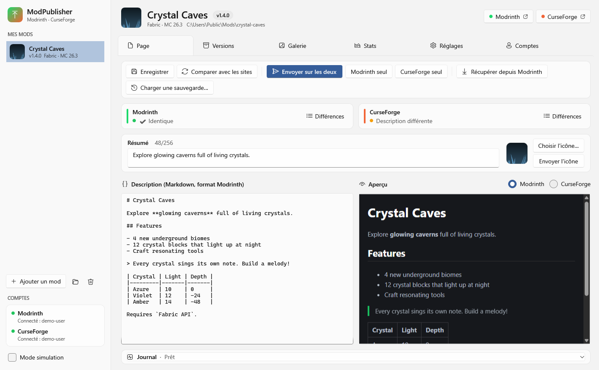
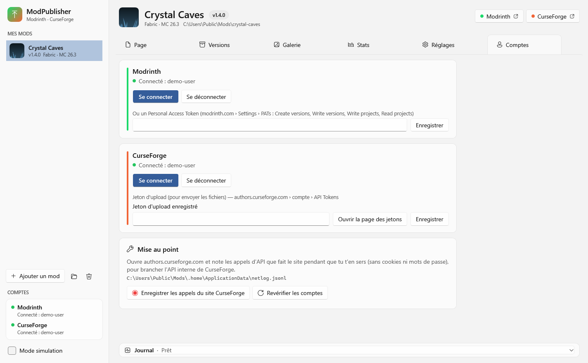
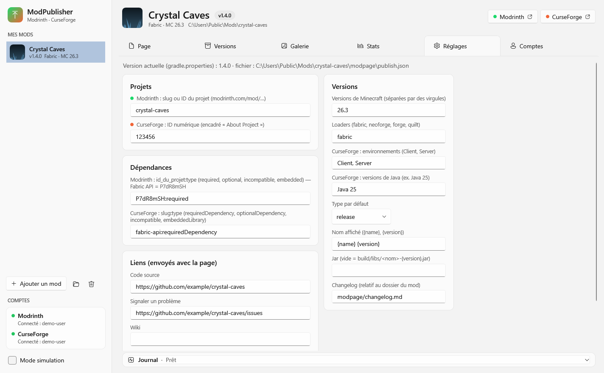
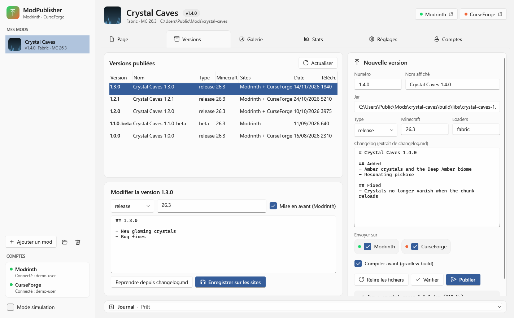
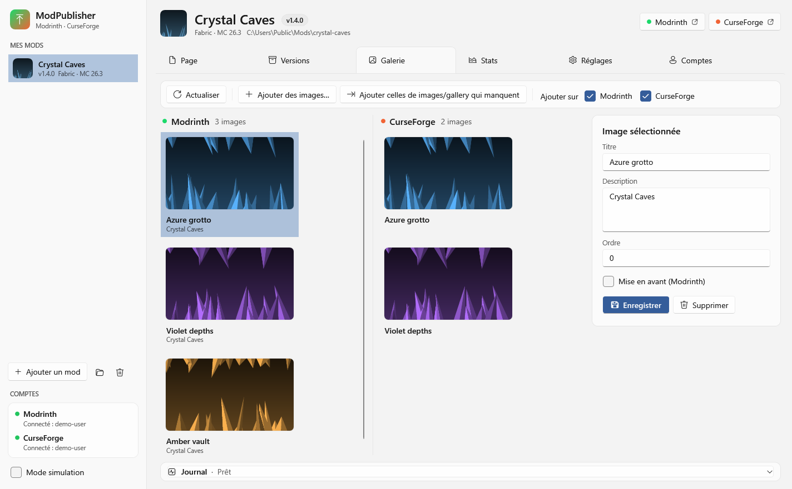
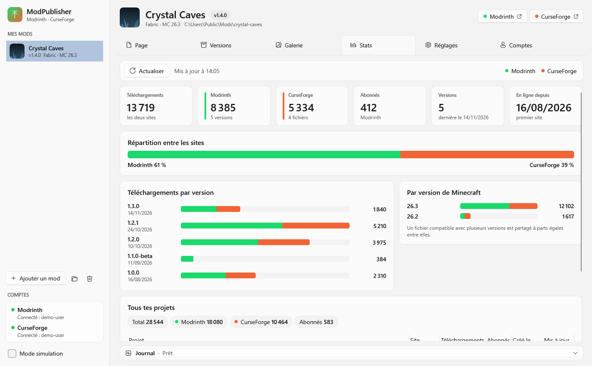
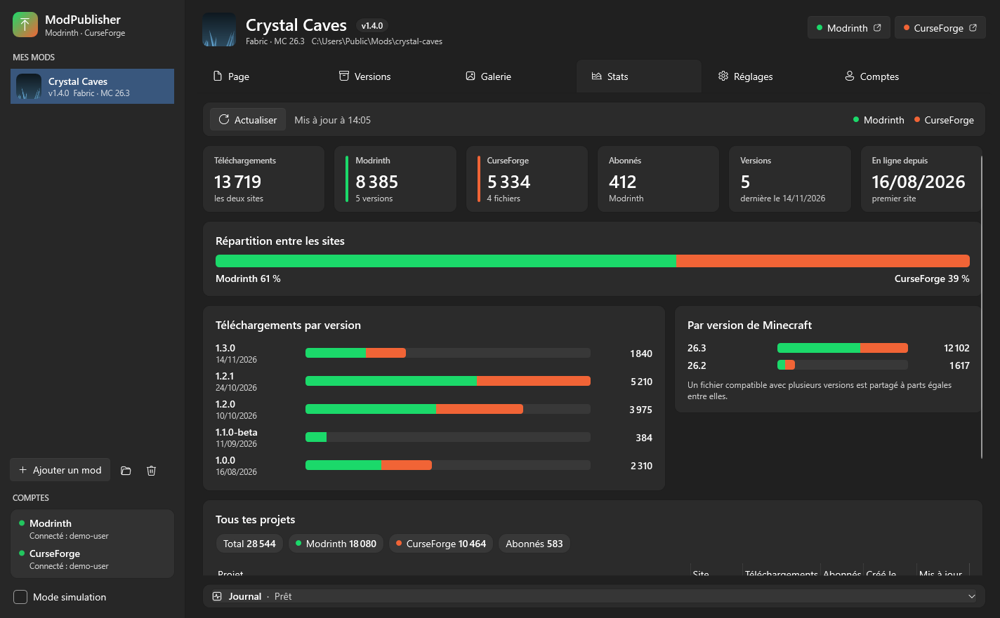

<p align="center"></p>
<h1 align="center">ModPublisher</h1>
<p align="center">Déploie les mises à jour de tes mods Minecraft sur <b>Modrinth</b> et <b>CurseForge</b> depuis une seule fenêtre.</p>
<p align="center"><a href="README.md">English</a> · <b>Français</b> · <a href="https://github.com/polo5922/ModPublisher/releases/latest"><b>Télécharger pour Windows</b></a> · <a href="https://paul-barbaux.dev/marketplace/modpublisher"><b>Marketplace</b></a></p>



> [!IMPORTANT]
> **Le mod doit déjà exister sur Modrinth et/ou CurseForge.**
> Crée le projet et envoie sa **première version à la main** sur chaque site, puis attends qu'elle soit acceptée.
> ModPublisher ne crée pas de projet : il sert ensuite à **déployer les mises à jour plus rapidement** (nouvelles versions, description, changelogs, icône, galerie).

## Ce que fait l'outil

- **Un clic, deux sites** : publie une nouvelle version sur Modrinth et CurseForge en même temps.
- **Une seule description** : écrite une fois en Markdown, convertie automatiquement pour CurseForge, avec un aperçu en direct.
- **Comparaison** : les différences entre tes fichiers et ce qui est en ligne, avant tout envoi.
- **Compilation comprise** : lance `gradlew build`, trouve le jar, lit la version dans `gradle.properties` et la bonne section du changelog.
- **Versions publiées modifiables** : changelog, type, versions de Minecraft, mise en avant.
- **Galerie et icône** : ajoute, renomme ou supprime les images de chaque site ; envoie l'icône du mod.
- **Statistiques** : téléchargements par site, par version et par version de Minecraft, abonnés, dates de sortie, et un tableau de tous les projets de tes comptes.
- **Prudent** : chaque écriture demande confirmation, le texte en ligne est sauvegardé avant d'être remplacé, et le *Mode simulation* montre les requêtes sans les envoyer.
- **Langue et thème automatiques** : français si Windows est en français, anglais sinon ; clair ou sombre comme Windows.

## Installation

1. Télécharge `ModPublisher-Setup-x.y.z.exe` depuis la [dernière version](https://github.com/polo5922/ModPublisher/releases/latest).
2. Lance-le. Pas besoin des droits administrateur, .NET est inclus. L'installateur n'est pas signé : Windows SmartScreen peut afficher un avertissement.

Il faut Windows 10 (1809) ou 11 en 64 bits, avec le [runtime WebView2](https://developer.microsoft.com/microsoft-edge/webview2/) (déjà présent sur la plupart des PC).

## Utilisation

### 1. Se connecter (onglet Comptes)



| Site | Ce qu'il faut | Sert à |
|---|---|---|
| Modrinth | *Se connecter*, ou un Personal Access Token (Create versions, Write versions, Write projects, Read projects) | Tout |
| CurseForge | *Se connecter* | Description, icône, galerie, modification des versions |
| CurseForge | Un **jeton d'upload** (authors.curseforge.com › compte › API Tokens) | Publier de nouveaux fichiers |

### 2. Ajouter le mod (onglet Réglages)

Clique **Ajouter un mod** et choisis le dossier du mod (celui qui contient `gradle.properties`). Renseigne ensuite le slug Modrinth et l'ID numérique CurseForge de tes projets **existants**, les versions de Minecraft, les loaders et les dépendances.



### 3. Publier une mise à jour (onglet Versions)

1. Augmente la version dans `gradle.properties` et écris le changelog.
2. Clique **Relire les fichiers** : numéro, nom, jar et changelog se remplissent.
3. Clique **Vérifier** : le jar, les versions du jeu et les projets sont contrôlés, rien n'est envoyé.
4. Clique **Publier** et confirme. CurseForge affiche le fichier une fois la modération passée.

À gauche se trouvent les versions déjà en ligne ; sélectionnes-en une pour la modifier.



### 4. Mettre à jour la page (onglet Page)

Modifie le résumé et la description, compare avec les sites, puis envoie aux deux (ou à un seul). Tu peux aussi repartir du texte en ligne sur Modrinth ou recharger une sauvegarde.

### 5. Gérer la galerie (onglet Galerie)

Chaque site a sa propre liste. L'ajout des images manquantes envoie celles de `modpage/images/gallery` qui ne sont pas encore en ligne, d'après leur titre.



### 6. Suivre les téléchargements (onglet Stats)

Clique **Actualiser** pour lire les chiffres du mod choisi sur les deux sites : total et part de chaque site, abonnés, téléchargements par version et par version de Minecraft (vert = Modrinth, orange = CurseForge). Le tableau du bas liste tous les projets de tes comptes ; double-clique sur l'un d'eux pour ouvrir sa page. Lecture seule, rien n'est envoyé.



### Thème sombre



## Fichiers dans le mod

Tout est dans un dossier `modpage/` à côté du code, à versionner avec lui. Il ne contient aucun secret.

```
mon-mod/
├─ gradle.properties        version (ou mod_version), archives_base_name
└─ modpage/
   ├─ publish.json          réglages (écrits par l'onglet Réglages)
   ├─ description.md        description, Markdown de Modrinth
   ├─ summary.txt           résumé court
   ├─ changelog.md          une section « # … 1.2.3 » par version
   └─ images/
      ├─ icon.png
      └─ gallery/           01_mon_image.png → titre « mon image »
```

## Bon à savoir

- **Jetons et sessions** restent sur ton PC. Les jetons sont chiffrés par Windows (DPAPI) pour ton compte utilisateur. L'app dialogue avec Modrinth et CurseForge ; les images de ta description sont chargées depuis leur hébergeur.
- **CurseForge** : les nouveaux fichiers passent par l'API d'upload officielle. Le reste utilise l'API interne du site des auteurs, faute d'API publique : elle peut cesser de marcher si le site change.
- **Données** : réglages et sauvegardes dans `%APPDATA%\ModPublisher`, sessions web dans `%LOCALAPPDATA%\ModPublisher`. La désinstallation les garde.
- `--lang en` ou `--lang fr` force la langue.
- **Compiler avant** lance le `gradlew.bat` du dossier du mod : n'ajoute que des dossiers de confiance.
- Sans lien avec Modrinth, CurseForge ou Mojang.

## Compiler depuis les sources

Il faut le SDK .NET 9, et [Inno Setup 6](https://jrsoftware.org/isinfo.php) pour l'installateur.

```powershell
dotnet run --project src/ModPublisher
```
```powershell
dotnet test tests/ModPublisher.Tests
```
```powershell
./installer/build.ps1
```
