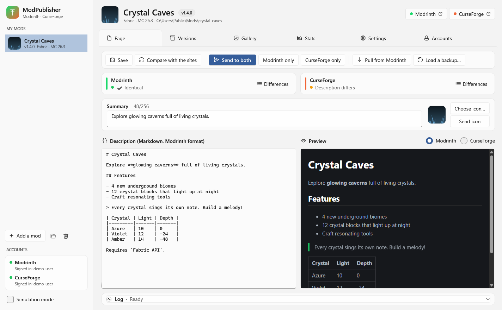
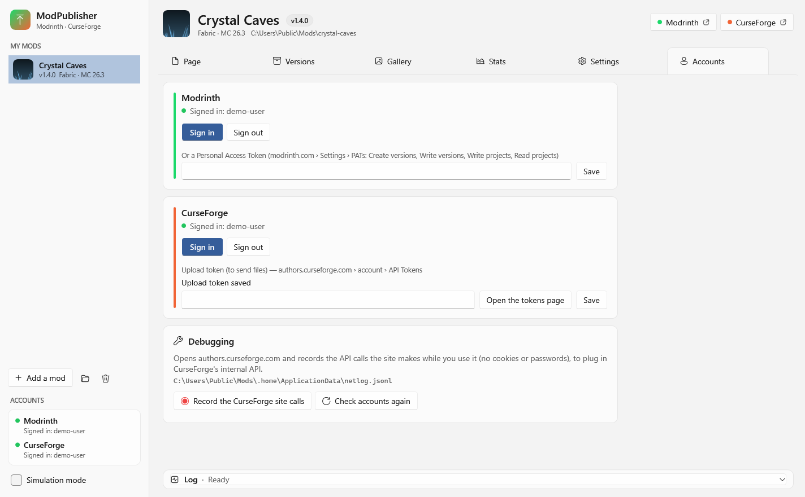
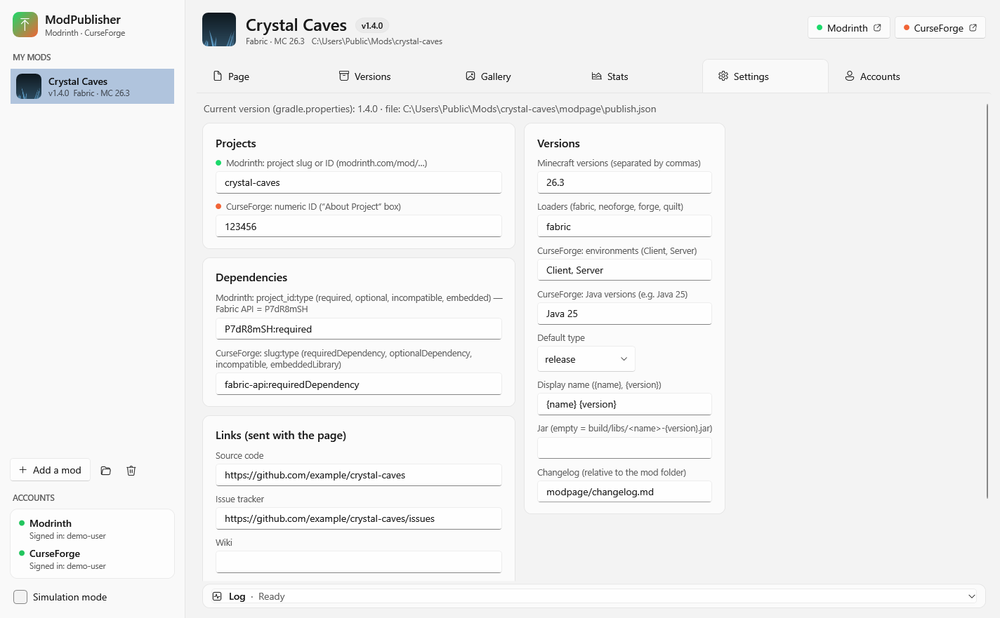
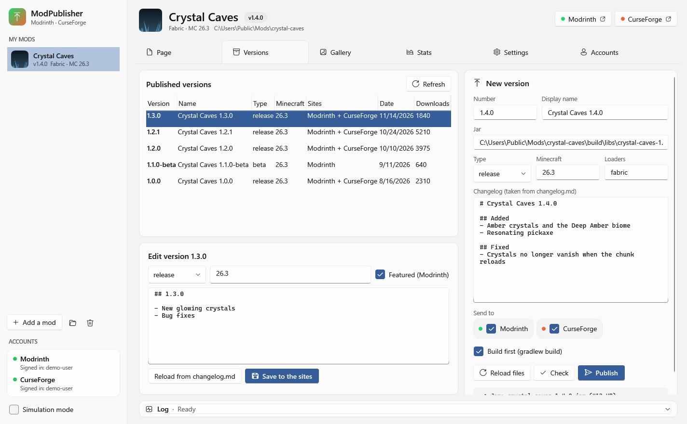
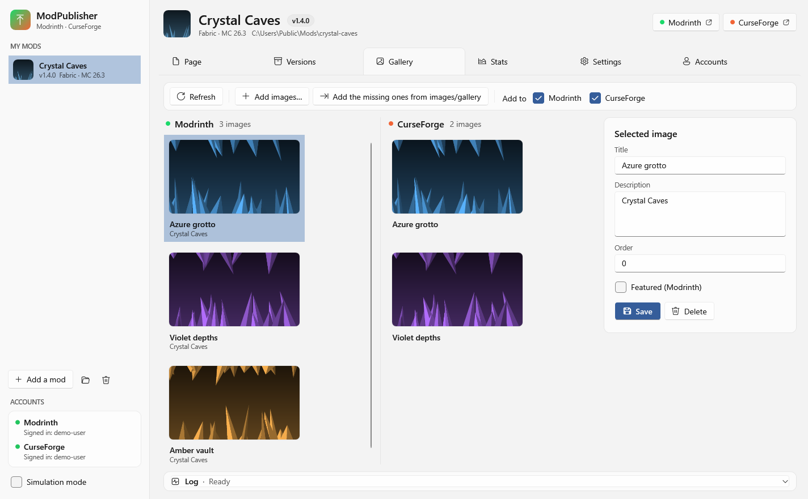
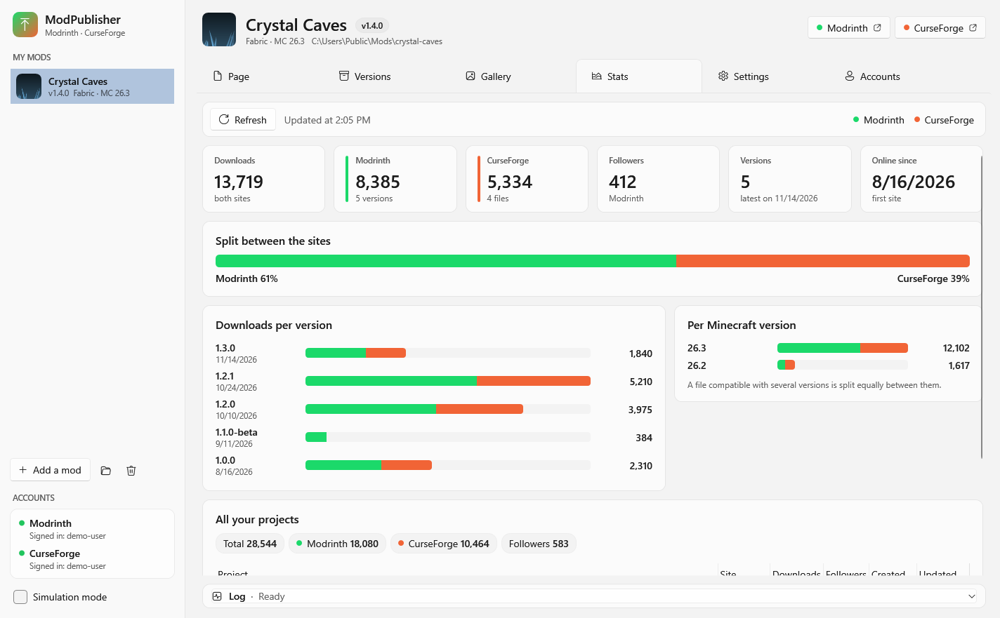
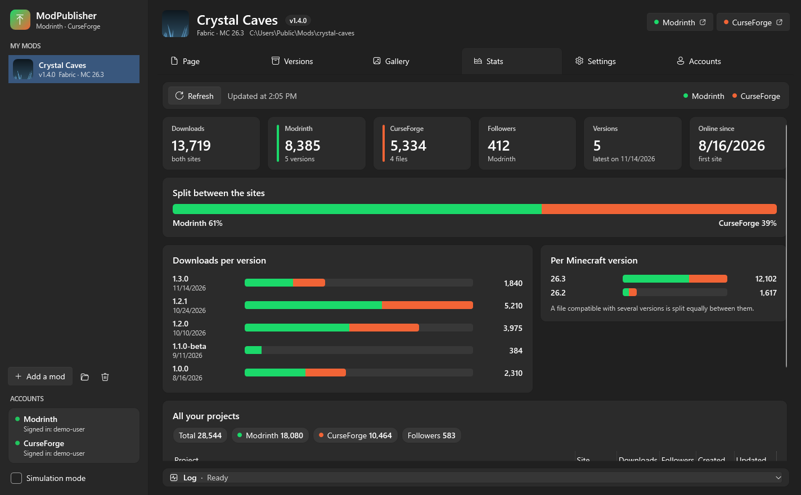

<p align="center"></p>
<h1 align="center">ModPublisher</h1>
<p align="center">Ship your Minecraft mod updates to <b>Modrinth</b> and <b>CurseForge</b> from one window.</p>
<p align="center"><b>English</b> · <a href="README.fr.md">Français</a> · <a href="https://github.com/polo5922/ModPublisher/releases/latest"><b>Download for Windows</b></a> · <a href="https://paul-barbaux.dev/en/marketplace/modpublisher"><b>Marketplace</b></a></p>



> [!IMPORTANT]
> **Your mod must already exist on Modrinth and/or CurseForge.**
> Create the project and send its **first version by hand** on each website, and wait until it is accepted.
> ModPublisher does not create projects: it is made to **deploy updates faster** afterwards (new versions, description, changelogs, icon, gallery).

## What it does

- **One click, two sites**: publish a new version to Modrinth and CurseForge at the same time.
- **One description**: write it once in Markdown; it is converted for CurseForge automatically, with a live preview.
- **Compare**: see the differences between your files and what is online before sending anything.
- **Build included**: runs `gradlew build`, finds the jar, reads the version from `gradle.properties` and the matching section of your changelog.
- **Edit published versions**: changelog, type, Minecraft versions, featured.
- **Gallery and icon**: add, rename or delete images on each site; send the mod icon.
- **Stats**: downloads per site, per version and per Minecraft version, followers, release dates, and a table of every project on your accounts.
- **Safe**: every write asks for confirmation, online text is backed up before it is replaced, and *Simulation mode* shows the requests without sending them.
- **Automatic language and theme**: French on a French Windows, English everywhere else; light or dark like Windows.

## Install

1. Download `ModPublisher-Setup-x.y.z.exe` from the [latest release](https://github.com/polo5922/ModPublisher/releases/latest).
2. Run it. No administrator rights needed, .NET is included. The installer is not code-signed, so Windows SmartScreen may warn you.

Requires 64-bit Windows 10 (1809) or 11, with the [WebView2 runtime](https://developer.microsoft.com/microsoft-edge/webview2/) (already present on most PCs).

## How to use it

### 1. Sign in (Accounts tab)



| Site | What you need | Used for |
|---|---|---|
| Modrinth | *Sign in*, or a Personal Access Token (Create versions, Write versions, Write projects, Read projects) | Everything |
| CurseForge | *Sign in* | Description, icon, gallery, editing versions |
| CurseForge | An **upload token** (authors.curseforge.com › account › API Tokens) | Publishing new files |

### 2. Add your mod (Settings tab)

Click **Add a mod** and choose the mod folder (the one with `gradle.properties`). Then fill in the Modrinth slug and the numeric CurseForge ID of your **existing** projects, the Minecraft versions, loaders and dependencies.



### 3. Publish an update (Versions tab)

1. Raise the version in `gradle.properties` and write your changelog.
2. Click **Reload files**: number, name, jar and changelog are filled in.
3. Click **Check**: the jar, the game versions and the projects are verified, nothing is sent.
4. Click **Publish** and confirm. CurseForge shows the file once it passes moderation.

The left side lists the versions already online; select one to edit it.



### 4. Update the page (Page tab)

Edit the summary and description, then **Compare with the sites** and **Send to both** (or to one only). **Pull from Modrinth** starts from the text that is already online, and **Load a backup** brings back an older one.

### 5. Manage the gallery (Gallery tab)

Each site has its own list. **Add the missing ones** sends the images of `modpage/images/gallery` that are not online yet, compared by title.



### 6. Follow your downloads (Stats tab)

Click **Refresh** to read the numbers of the selected mod on both sites: total and share per site, followers, downloads per version and per Minecraft version (green = Modrinth, orange = CurseForge). The bottom table lists every project on your accounts; double-click one to open its page. Read only, nothing is sent.



### Dark theme



## Files in your mod

Everything lives in a `modpage/` folder next to your code, so it can be versioned with it. It contains no secrets.

```
my-mod/
├─ gradle.properties        version (or mod_version), archives_base_name
└─ modpage/
   ├─ publish.json          settings (written by the Settings tab)
   ├─ description.md        description, Modrinth Markdown
   ├─ summary.txt           short summary
   ├─ changelog.md          one "# … 1.2.3" section per version
   └─ images/
      ├─ icon.png
      └─ gallery/           01_my_image.png → title "my image"
```

## Good to know

- **Tokens and sessions** stay on your PC. Tokens are encrypted with Windows DPAPI for your user account. The app talks to Modrinth and CurseForge; images embedded in your description are loaded from wherever they are hosted.
- **CurseForge**: new files use the official upload API. The rest uses the internal API of the authors website, because there is no public one: it may stop working if the website changes.
- **Data**: settings and backups are in `%APPDATA%\ModPublisher`, web sessions in `%LOCALAPPDATA%\ModPublisher`. Uninstalling keeps them.
- `--lang en` or `--lang fr` forces the language.
- **Build first** runs the `gradlew.bat` of the mod folder: only add folders you trust.
- Not affiliated with Modrinth, CurseForge or Mojang.

## Build from source

Requires the .NET 9 SDK, and [Inno Setup 6](https://jrsoftware.org/isinfo.php) for the installer.

```powershell
dotnet run --project src/ModPublisher
```
```powershell
dotnet test tests/ModPublisher.Tests
```
```powershell
./installer/build.ps1
```
